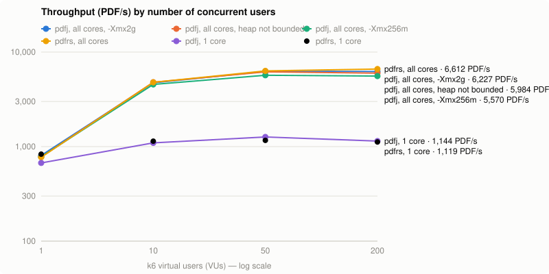
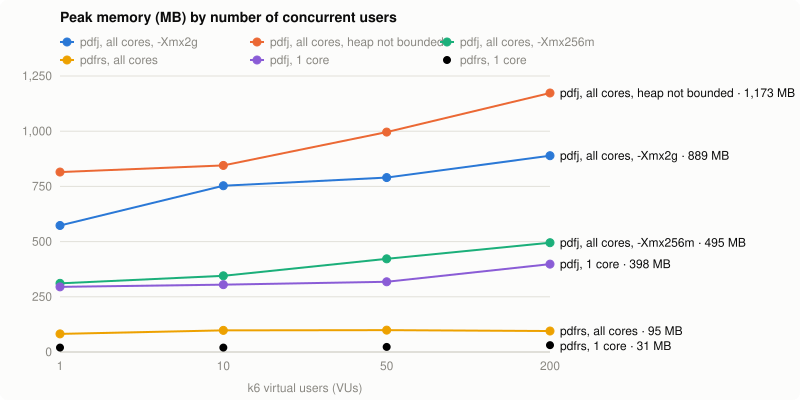
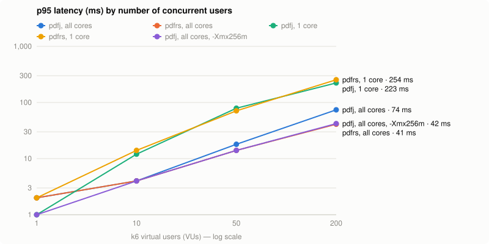

# pdfj

[](https://github.com/gouz/pdfj/actions/workflows/ci.yml)

Generates PDFs from HTML/CSS, **without a browser**: a Java port of [`pdfrs`](https://github.com/gouz/pdfrs) (itself a Rust port of [`@gouz/pdfjs`](https://github.com/gouz/pdfjs)), shipped as a small HTTP API in a ~80 MB distroless Docker image, with the same API, options, templates and CSS support as pdfrs, and the same output (see [Fidelity](#fidelity)).

- HTML parsing and CSS selectors by [jsoup](https://jsoup.org)
- Layout by its own engine, in plain Java: block (with margin collapsing), flexbox, **grid**, float, absolute positioning, tables as grids
- Text by its own engine too: per-character font fallback, Unicode line breaking (UAX #14), bidi, Arabic contextual forms, justification, line boxes computed like a browser (and like Parley, what pdfrs uses)
- PDF by [PDFBox](https://pdfbox.apache.org): subset embedded fonts, selectable text, clickable links; SVG drawn as vectors by [Batik](https://xmlgraphics.apache.org/batik/)
- Templates by [Jinjava](https://github.com/HubSpot/jinjava) (Jinja syntax)

## Getting started

```bash
docker build -t pdfj . && docker run -p 3000:3000 pdfj
# or with Java 21 and Maven
mvn package -DskipTests && FONTS_DIR=/usr/share/fonts java -jar target/pdfj.jar
```

The image (amd64 and arm64) is published by CI ([`.github/workflows/ci.yml`](.github/workflows/ci.yml)): `:main` and `:sha-xxxxxxx` on every push to `main`. A `v1.2.3` tag is not built again: the image `main` built for that commit gets `:1.2.3`, `:1.2` and `:latest` (push the commit to `main` before or with its tag). Pull requests run the tests and build the image without publishing it.

```bash
# raw HTML in the body, options in the query string
curl --data-binary @invoice.html 'http://localhost:3000/?size=A4&margin=40' -o invoice.pdf

# or as JSON
curl -H 'content-type: application/json' \
  -d '{"html": "<h1>Hello</h1>", "footer": "<p style=\"text-align:right\">{page} / {pages}</p>"}' \
  http://localhost:3000/ -o hello.pdf
```

| Route | |
|---|---|
| `POST /` or `POST /pdf` | body: the HTML (`text/html`, or anything), or `{"html": …, …options}` / `{"template": …, "data": {…}}` / `{"template_name": …, "data": {…}}` (`application/json`, see [Templates](#templates)). Response: `application/pdf` |
| `GET /health` | `ok` |
| `GET /` | usage |

Errors: `400` for an invalid option or a template / data error (the message says which one, and where), `413` for a body over `MAX_BODY_MB`, `500` if rendering fails.

### Options

As query parameters or JSON fields:

| Option | Example | |
|---|---|---|
| `size` | `A5`, `LETTER`, `400x600` | page size (`A4` by default, `A3`, `A6`, `B5`, `LEGAL`, `TABLOID`, or `WIDTHxHEIGHT` in pt) |
| `landscape` | `true` | landscape orientation |
| `margin` | `40`, `60 40 50 40` | margins in pt (40 by default), CSS order top right bottom left, commas accepted |
| `font` | `Times-Roman` | default font (`Helvetica` by default) |
| `fontSize` | `11` | default size (12) |
| `header` | `<p>Report</p>` | header repeated on every page, vertically centered in the top margin |
| `footer` | `<p>{page} / {pages}</p>` | footer repeated on every page |
| `title`, `author`, `subject`, `keywords` | | PDF metadata (`title` falls back to `<title>`) |

`size`, `landscape` and `margin` can also come from the document: `@page { size: A5 landscape; margin: 10mm }`. `var()` works there too, with the custom properties of `:root`. An option passed with the request wins over `@page`.

### Environment variables

| Variable | Default | |
|---|---|---|
| `PORT` | `3000` | |
| `WORKERS` | number of cores | render threads; extra requests wait their turn |
| `FONTS_DIR` | `/fonts` in the image (`/usr/share/fonts:/fonts` outside) | font directories (`.ttf`, `.otf`, `.ttc`, `.woff`, `.woff2`, recursive), separated by `:` |
| `IMAGES_DIR` | — | directory for local images, stylesheets and fonts, see [Images](#images) |
| `TEMPLATES_DIR` | — | directory of the templates (`template_name`), see [Templates](#templates); also the image directory when `IMAGES_DIR` is not set |
| `LOCALE` | `fr` | default locale of the `money` / `number` / `date` template filters |
| `REMOTE_RESOURCES` | off | `1`: also load http(s) images, stylesheets and fonts, see [Remote resources](#remote-resources) |
| `REMOTE_HOSTS` | any public host | comma separated allow-list: `cdn.example.com,*.example.org` |
| `REMOTE_TIMEOUT_MS` / `REMOTE_MAX_MB` | `5000` / `10` | per download |
| `REMOTE_ALLOW_PRIVATE` | off | `1`: allow loopback and private addresses (a trusted internal network only) |
| `MAX_BODY_MB` | `20` | maximum request size |
| `JAVA_TOOL_OPTIONS` | `-Xmx256m` in the image | JVM options: `-Xmx1g` for very large documents or many large images |

## Templates

Instead of HTML, send a [Jinja](https://jinja.palletsprojects.com) template (rendered by [Jinjava](https://github.com/HubSpot/jinjava)) and its data: pdfj fills the template, then renders it. Callers send data, the layout lives in the templates.

```bash
# a template of TEMPLATES_DIR
curl -H 'content-type: application/json' -d '{
  "template_name": "facture.html",
  "data": { "numero": "2026-0142", "client": { "nom": "ACME" }, "lignes": [{ "libelle": "Café", "quantite": 2, "prix": 3 }] },
  "size": "A4"
}' http://localhost:3000/ -o facture.pdf

# or the template itself, inline
curl -H 'content-type: application/json' -d '{
  "template": "<h1>Facture {{ numero }}</h1><p>{{ l.libelle }} : {{ l.prix | money }}</p>",
  "data": { "numero": 42, "lignes": [{ "libelle": "Café", "prix": 3 }] },
  "locale": "en"
}' http://localhost:3000/ -o facture.pdf

docker run -p 3000:3000 -v ./templates:/templates:ro -e TEMPLATES_DIR=/templates pdfj
```

| Field | |
|---|---|
| `template` / `template_name` | the template's text, or the name of a file of `TEMPLATES_DIR` (`facture.html`, `clients/acme.html`); one of them, or `html` |
| `data` | a JSON object: the template's variables |
| `locale` | `fr` (default, or `LOCALE`), `en`, `de`, `es`, `it`, `fr-CH`…: digit grouping, decimal mark, currency position, month names |
| `header`, `footer` | templates too (same data), with `{page}` / `{pages}` |
| every other option | `size`, `margin`, `title`… as for HTML |

- **Syntax**: `{{ client.nom }}`, `…`, `…`, `` for sums in a loop, `loop.index`, `{# comments #}`, macros, and Jinjava's [built-in filters](https://github.com/HubSpot/jinjava/tree/master/src/main/java/com/hubspot/jinjava/lib/filter) (`default`, `length`, `round`, `sum`, `upper`, `join`, `sort`, `groupby`, `tojson`…).
- **Layouts**: `` and `` read other templates of `TEMPLATES_DIR` (an inline template can extend them too). The name can be an expression: ``. A template edited on disk is picked up by the next request, no restart.
- **Strict**: a variable missing from the data is an error (`400`, with the template and the line), so a typo in the data does not print an empty invoice. Optional fields: `{{ client.tva | default("") }}`, ``. A `null` of the data is a value, not a missing one: `` is false, `{{ remise }}` prints nothing, `{{ remise or "—" }}` prints the dash, and `remise is defined` is true.
- **Escaped**: every `{{ … }}` is HTML-escaped, a `<` or `</td>` in the data cannot break the document or inject markup. `| safe` opts out, for trusted HTML only.
- **Bounded**: a template only reads files of its directory (no `../`, absolute path or symlink out of it), a recursion limit, a budget of loop items (`range()`: an endless loop is a `400`, not a stuck render thread) and of output size.
- Images, stylesheets and fonts of the templates (``, `<link href="style.css">`) come from `TEMPLATES_DIR` unless `IMAGES_DIR` is set.

Filters for business documents:

| Filter | `fr` | `en` |
|---|---|---|
| `{{ 1234.5 \| money }}` | `1 234,50 €` | `€1,234.50` |
| `{{ 99 \| money("USD") }}` | `99,00 $` | `$99.00` |
| `{{ total \| money(decimals=0) }}` | `1 235 €` | `€1,235` |
| `{{ 1234.5 \| number }}` / `number(2)` | `1 235` / `1 234,50` | `1,235` / `1,234.50` |
| `{{ "2026-10-15" \| date }}` | `15/10/2026` | `10/15/2026` |
| `{{ "2026-10-15" \| date("%A %e %B %Y") }}` | `jeudi 15 octobre 2026` | `Thursday 15 October 2026` |
| `{{ adresse \| nl2br }}` | line breaks as `<br>`, escaped | |

Amounts are rounded half away from zero (`2.675` → `2,68`), dates are `YYYY-MM-DD` with an optional time (`2026-10-15T08:30:00Z`, `%H:%M`), any filter takes `locale="…"` to override the request's.

From the command line, `--data` makes the input a template of its folder:

```bash
java -jar target/pdfj.jar demo/templates/facture.html facture.pdf --data demo/templates/facture.json --locale fr
```

[`demo/templates/`](demo/templates) holds a complete invoice: `base.html` (styles, `@page`, numbered footer), `facture.html` (`extends` it; totals computed in the template), `facture.json`, rendered as [`demo/facture.pdf`](demo/facture.pdf) (2 pages, numbered footer).

## Deploy on Google Cloud Run

A stateless HTTP container: a good fit for [Cloud Run](https://cloud.google.com/run). The server listens on `$PORT`, which Cloud Run sets.

**1. Put the image in Artifact Registry.** Cloud Run pulls from Artifact Registry or Docker Hub, not from ghcr.io. Either copy the published image:

```bash
PROJECT=my-project REGION=europe-west1
gcloud artifacts repositories create pdfj --repository-format=docker --location=$REGION
gcloud auth configure-docker $REGION-docker.pkg.dev
docker pull --platform linux/amd64 ghcr.io/gouz/pdfj:0.0.2
docker tag ghcr.io/gouz/pdfj:0.0.2 $REGION-docker.pkg.dev/$PROJECT/pdfj/pdfj:0.0.2
docker push $REGION-docker.pkg.dev/$PROJECT/pdfj/pdfj:0.0.2
```

or build it from the sources with Cloud Build (it uses the `Dockerfile`):

```bash
gcloud builds submit --tag $REGION-docker.pkg.dev/$PROJECT/pdfj/pdfj:0.0.2
```

**2. Deploy.**

```bash
gcloud run deploy pdfj \
  --image=$REGION-docker.pkg.dev/$PROJECT/pdfj/pdfj:0.0.2 \
  --region=$REGION \
  --cpu=2 --memory=512Mi \
  --set-env-vars=WORKERS=2 \
  --concurrency=40 \
  --min-instances=0 --max-instances=10 \
  --no-allow-unauthenticated
```

- **CPU**: rendering is CPU-bound, one render thread per vCPU (`WORKERS` = `--cpu`). Cloud Run scales out by instances, so 1 or 2 vCPUs per instance is enough.
- **Memory**: the image bounds the heap to 256 MB (`JAVA_TOOL_OPTIONS=-Xmx256m`), ~450 MB of memory in all under load: 512 MiB is enough, 1 GiB if you raise the heap for very large documents.
- **Concurrency**: requests beyond `WORKERS` wait in the instance's queue. A lower `--concurrency` makes Cloud Run add instances sooner (lower latency), a higher one packs more requests per instance (lower cost). ~20 per vCPU is a good start.
- **Request size**: Cloud Run accepts up to 32 MB per request; `MAX_BODY_MB` (20 by default) is checked first.
- **Cold start**: the server answers `/health` ~0.5 s after its container starts (JVM and fonts loaded), measured locally; Cloud Run adds the instance start-up on top. The first requests are slower while the JVM compiles its hot paths (a few seconds of traffic); `--min-instances=1` keeps one instance warm, and `--cpu-boost` speeds the start-up.

**3. Call it.** Unauthenticated calls are refused (`--no-allow-unauthenticated`): callers need the `roles/run.invoker` role and an identity token.

```bash
URL=$(gcloud run services describe pdfj --region=$REGION --format='value(status.url)')
curl -H "Authorization: Bearer $(gcloud auth print-identity-token)" \
  --data-binary @invoice.html "$URL/?size=A4" -o invoice.pdf
```

From another Cloud Run service or a Cloud Function, fetch the identity token for the audience `$URL` from the metadata server (the Google client libraries do it: `google.oauth2.id_token.fetch_id_token`, `GoogleAuth.getIdTokenClient`…). Use `--allow-unauthenticated` only for a public demo: anyone could then make the service render (and pay for the CPU).

**Images, stylesheets and fonts from Cloud Storage.** Mount a bucket and point `IMAGES_DIR` (and `FONTS_DIR`) at it:

```bash
gcloud run services update pdfj --region=$REGION \
  --add-volume=name=assets,type=cloud-storage,bucket=my-pdf-assets,readonly=true \
  --add-volume-mount=volume=assets,mount-path=/assets \
  --update-env-vars=IMAGES_DIR=/assets,FONTS_DIR=/fonts:/assets/fonts
```

Templates the same way: `--update-env-vars=TEMPLATES_DIR=/assets/templates` serves the templates of `gs://my-pdf-assets/templates/` (edited templates are picked up without redeploying). `` then reads `gs://my-pdf-assets/logo.png`, and the fonts of `gs://my-pdf-assets/fonts/` are loaded at start-up (redeploy to pick up new fonts). The service account of the service needs `roles/storage.objectViewer` on the bucket.

**Remote resources on GCP.** If you enable them (`REMOTE_RESOURCES=1`), keep the guards on: the metadata server (`169.254.169.254`, `metadata.google.internal`) hands out access tokens of the service account, and is precisely what an SSRF goes after. pdfj refuses link-local and private addresses, so it is not reachable from a document; never set `REMOTE_ALLOW_PRIVATE=1` on Cloud Run. Prefer `REMOTE_HOSTS` with the hosts your templates actually use. Through a VPC connector with all traffic routed to the VPC, remote resources need Cloud NAT to reach the internet.

## Command line

The same jar converts a file:

```bash
java -jar target/pdfj.jar invoice.html invoice.pdf --size A5 --footer '<p>{page} / {pages}</p>'
# or inside the image
docker run --rm -v "$PWD":/w -w /w pdfj invoice.html invoice.pdf   # the image runs the jar
```

Options: `--size`, `--landscape`, `--margin`, `--font`, `--font-size`, `--header`, `--footer`, `--title`, `--remote`, `--data data.json` (the input is a [template](#templates)), `--locale`. Local images, stylesheets and fonts are allowed from the HTML file's folder.

## Fonts

The image ships **Liberation Sans / Serif / Mono**, metric-compatible with Helvetica / Times / Courier (a document takes the same space as with pdfjs), and **DejaVu Sans** as a fallback for missing characters (arrows, symbols, Greek, Cyrillic, Hebrew, Arabic…).

- `Helvetica`, `Arial`, `sans-serif`, `system-ui` → Liberation Sans; `Times-Roman`, `serif` → Liberation Serif; `Courier`, `monospace` → Liberation Mono.
- As in a browser, a stack like `font-family: "Segoe UI", Roboto, sans-serif` uses the first available font. If none is available, the declaration is ignored and the parent's font applies.
- A document can bring its own fonts with `@font-face` (`font-family`, `src`, `font-weight`, `font-style`): `src: url(data:font/woff2;base64,…)`, or a file of `IMAGES_DIR` (`src: url(fonts/Inter.woff2)`). TrueType, OpenType (TrueType outlines), WOFF and WOFF2. They are visible to that document only (and its header / footer).
- To add fonts for every document, mount them into the container: `docker run -v ./fonts:/fonts/extra pdfj` (all of `FONTS_DIR` is scanned). They are usable by family name, in CSS as well as in the `font` option. Bold and italic use the family's matching files when they exist.
- No CJK font in the image: add for example Noto Sans CJK to `FONTS_DIR` for Chinese, Japanese or Korean.
- OpenType fonts with CFF (PostScript) outlines are skipped, as are WOFF2 font collections.

## Images

The HTML may come from an untrusted source, so **by default only `data:` images are loaded**.

| Source | Allowed if… |
|---|---|
| `data:image/...` | always |
| `logo.png`, `img/a.jpg` | `IMAGES_DIR` is set and the file is **inside** that directory (`../`, absolute paths and symlinks pointing outside are refused) |
| `https://...` | remote resources are enabled (`REMOTE_RESOURCES=1`, `--remote`), see below |
| `file://`, others | never |

```bash
docker run -p 3000:3000 -v ./templates/img:/images:ro -e IMAGES_DIR=/images pdfj
```

A refused or missing image is not displayed and a warning is written to stderr.

Formats: PNG, JPEG, GIF, WebP and SVG (in `` or inline `<svg>…</svg>` in the HTML). Images are inline, as in a browser: they sit in the line of text (`vertical-align` applies, `text-align: center` centers them); `display: block`, a float or being a flex / grid item takes them out of the line. An image without a size keeps its natural size (1 px = 0.75 pt), without exceeding the available width; `width` / `height` (attributes or CSS) are honored, keeping the aspect ratio when only one is given. `object-fit` and `border-radius` are supported. JPEG files are embedded as they are, PNG files too when PDF can take their data (else they are compressed again, once: the result is kept for the next documents). An SVG never loads anything outside its own markup.

### Remote resources

Off by default: the HTML may be untrusted, and fetching a URL it names is the server making a request on its author's behalf (SSRF: cloud metadata endpoints, internal services). With `REMOTE_RESOURCES=1` (or `--remote`), `http(s)` images, background images, `<link>` / `@import` stylesheets and `@font-face` fonts are downloaded, with these guards:

- `http` and `https` only;
- addresses resolving to loopback, private, link-local, unique-local, carrier-grade NAT or multicast networks are refused, checked on every resolution (a JVM DNS resolver provider): redirects (3 at most, each checked) and DNS rebinding cannot get around it;
- optional host allow-list (`REMOTE_HOSTS`), timeout and size limit per download;
- each URL is downloaded once per document, the `` of a document 8 at a time.

A refused or failed download is reported on stderr and rendered as a missing image / stylesheet / font.

## Supported CSS

As in a browser, **1 px = 0.75 pt** (96 px per inch); a unitless length is in pt. `vw` / `vh` / `vmin` / `vmax` are relative to the page area.

- **Layout**: `display` `block` / `inline` / `inline-block` / `flex` / `inline-flex` / `grid` / `inline-grid` / `none` / `contents` / `list-item` / `table…`, margins that collapse like in a browser, `float` / `clear` with **text wrapping around floats** (images, boxes, drop caps: lines beside a float are shortened, then take the full width below it; a line with no room beside it goes below), `position: absolute` (relative to the parent).
- Full **flexbox**: `flex-direction`, `flex-wrap`, `flex` / `flex-grow` / `flex-shrink` / `flex-basis`, `justify-content`, `align-items`, `align-self`, `align-content`, `gap`, `order`.
- **Grid**: `grid-template-columns` / `-rows` (`fr`, `repeat()`, `minmax()`, `auto`…), `grid-column` / `grid-row`, `grid-auto-flow`, `gap`, `justify-items`, `place-items`… Every child is a grid / flex item, inline ones (`<span>`, `<a>`) included.
- **Boxes**: `width` / `height` (+ `min-` / `max-`), `box-sizing`, `margin`, `padding`, `border` (width, `solid` / `dashed` / `dotted`, color per side), `border-radius`, `background-color`, `opacity`, `overflow: hidden`, `aspect-ratio`.
- **Backgrounds**: colors, gradients and `url()` images, **several layers** (first on top), with `background-size` (`cover`, `contain`, lengths, `%`), `background-position` (keywords, lengths, `%`, `right 10px bottom 5px`), `background-repeat`, `background-origin` and `background-clip` (`border-box`, `padding-box`, `content-box`, and `text`: gradient text, with `-webkit-text-fill-color`), `background-attachment: fixed` (against the page, on every page); all in the `background` shorthand too. The `html` / `body` background covers the whole page, margins included, like a browser's canvas.
- **Shadows**: `box-shadow` with offsets, blur, spread, color, `inset`, several shadows; a blurred shadow is drawn as a bitmap (~2 px per pt), an unblurred one as a crisp vector shape.
- **Transforms**: `transform` (`translate`, `scale`, `rotate`, `skew`, `matrix`, their `X` / `Y` forms, combined) and `transform-origin`. As in CSS, the layout is unchanged; links in a transformed box keep their untransformed area.
- **Generated content**: `::before` / `::after` (and `:before` / `:after`) with `content` strings, escapes (`"\201C"`), `attr()`, `open-quote` / `close-quote`, `counter()` / `counters()`, any style; `display: block` makes a box. `<q>` gets quotes. `::marker` styles list markers and can replace them (`content: "✓ "`); `::first-letter` styles the first letter of a block (floated: a drop cap the text wraps around); `::first-line` styles the first line as laid out (its text is shaped again until the styled line fits).
- **Counters**: `counter-reset`, `counter-increment`, `counter-set`, scoped as in CSS (a reset is visible to the following siblings), the implicit `list-item` counter of lists (`<ol start>`, `<li value>`), any list style (`counter(chapter, upper-roman)`); table rows and cells count too.
- **Values**: custom properties `--name` and `var(--name, fallback)` (inherited, nestable), `calc()` (`+ - * /`, parentheses, any mix of units, `calc(100% - 20px)` included), `min()` / `max()` / `clamp()` on absolute lengths.
- **At-rules**: `@media` (`print` / `all` match, `screen` does not; `min-` / `max-width` / `-height`, range syntax `(width >= 600px)`, `orientation`, `not`, lists; evaluated against the page area), `<style media="…">`, `<link rel="stylesheet">` and `@import` (files of `IMAGES_DIR`, or remote resources; `url()` relative to the stylesheet), `@supports` (assumed true), `@font-face`, and `@page`: size, margins, `:first` / `:left` / `:right` (mirrored margins move the column, its width stays), named pages (`@page wide { size: A4 landscape }` + `page: wide` on a top-level element: a section laid out at its own width, numbering and counters carry on), every margin box (`@top-left` / `-center` / `-right`, `@bottom-…`, corners `@top-left-corner`…, sides `@left-top` / `-middle` / `-bottom`, `@right-…`) with `content`, `counter(page)` / `counter(pages)` and any text style; the `header` / `footer` options win over the top / bottom boxes.
- **Right-to-left**: `dir="rtl"` / `direction: rtl` (bidi text, alignment, flex and grid order, list markers on the right). Hebrew and Arabic (contextual forms, lam-alef ligatures) are drawn with DejaVu Sans.
- **Inline boxes**: `inline-block` (and `inline-flex` / `-grid` / `-table`) and images sit in the line of text like in a browser: padding, borders and backgrounds are kept, the box shrinks to fit the line when it is too wide, and `vertical-align` (`baseline`, `middle`, `top`, `bottom`, `text-top`, `text-bottom`) places it; `text-align` centers an image. Direct children of a flex or grid box are items instead, as in CSS.
- **Text**: `vertical-align` (`sub`, `super`, lengths, `%` of the line height) for text and inline boxes, `font` / `font-family` / `font-size` / `font-weight` / `font-style`, `color`, `text-align` (including `justify`), `line-height`, `text-decoration`, `text-transform`, `letter-spacing`, `word-spacing`, `white-space` (`pre`, `nowrap`…), background of inline elements (`<mark>`, `<span style="background">`).
- **Units**: `px`, `pt`, `em`, `rem`, `%`, `mm`, `cm`, `in`, `pc`. Colors: names, `#hex`, `rgb()`, `hsl()`…
- **Pagination**: automatic page breaks between lines of text (never through a line, an image or a table cell that fits on a page), `page-break-before` / `-after: always` (or `break-before: page`), `page-break-inside: avoid`. A table that continues on the next page repeats its `<thead>` at the top, and its `<tfoot>` at the bottom of each page it breaks on.
- **HTML**: tables (grid with `colspan` / `rowspan`, column widths from `<col>` / `<colgroup>` or the cells' `width`, the room left in a table with a width shared like Chromium (auto columns by their content, else fixed columns by their width, else percentages), `border-collapse`, `border-spacing`, `vertical-align`), lists (`disc`, `circle`, `square`, `decimal`, `lower-alpha`, `upper-roman`…, `<ol start>`, `<li value>`), clickable links (`http(s):`, `mailto:`, `tel:`), `<br>`, `<pre>`, `<svg>`, browser default styles (`h1`…`h6`, `b`, `i`, `code`…), `align` / `bgcolor` attributes.
- `<style>` with all CSS selectors (`>`, `+`, `~`, `:first-child`, `:nth-child()`, `[attr]`, `:not()`…), specificity and `!important`.

**Not supported**: a first page wider or narrower than the others (the text would have to change width mid-paragraph; a named page covers a different cover page), floats that do not precede text in the same block (a float followed by blocks narrows them, the text does not flow back under it), `clear` on text after a float, `background-clip: text` with images (gradients only), `@page` named pages for nested elements (top-level ones only).

**Differences from pdfjs**:
- Vertical margins collapse like in a browser (react-pdf adds them up): paragraphs are slightly tighter.
- No infinite loop or crash on a `min-height` taller than the page, `gap: normal`, `border: medium` or an unknown font: nothing to work around.
- Much more CSS: grid, gradients, transforms, shadows, `::before` / `::after` / `::marker`, counters, `var()`, `calc()`, `@media`, `@page` with margin boxes, `@font-face` (WOFF2 too), `<link>` stylesheets, right-to-left text, repeated table headers and footers.
- Remote images, stylesheets and fonts only when enabled, with SSRF guards.

## Fidelity

pdfj lays documents out like pdfrs: the same box model, flex and grid algorithms, the same table column rules, and line boxes computed the way Parley 0.12 computes them (metrics from `hhea` or `OS/2` like FreeType, rounded to whole pixels, half-leading, strut, `sub` / `super` offsets). On the documents of [`demo/`](demo), text lines, table rows and page breaks fall at the same places as pdfrs's, to a fraction of a point.

Differences:

- No OpenType shaping beyond Arabic contextual forms (presentation forms): no kerning, no ligatures, no complex scripts (Indic…); words are a hair wider than with HarfRust.
- SVG text is drawn as outlines (not selectable).
- The JVM needs more memory than the Rust binary, and a few seconds of traffic to reach its full speed.

## Examples

| Source | Output | |
|---|---|---|
| [`demo/example.html`](demo/example.html) | [`demo/example.pdf`](demo/example.pdf) | simple invoice |
| [`demo/flex.html`](demo/flex.html) | [`demo/flex.pdf`](demo/flex.pdf) | flexbox |
| [`demo/images.html`](demo/images.html) | [`demo/images.pdf`](demo/images.pdf) | images and the image policy |
| [`demo/report.html`](demo/report.html) | [`demo/report.pdf`](demo/report.pdf) | 3 pages: grid, lists, SVG, `<pre>`, long table with a repeated header, forced page break (rendered with a header and a footer) |
| [`demo/inline.html`](demo/inline.html) | [`demo/inline.pdf`](demo/inline.pdf) | badges, buttons, cards and images in the line of text, shrink-to-fit, `vertical-align`, `<sub>` / `<sup>` |
| [`demo/backgrounds.html`](demo/backgrounds.html) | [`demo/backgrounds.pdf`](demo/backgrounds.pdf) | `box-shadow`, `background-image` (tiles, `cover`, `contain`, position), a 2-page table repeating its `<thead>` |
| [`demo/floats.html`](demo/floats.html) | [`demo/floats.pdf`](demo/floats.pdf) | text wrapping around a floated image and box, a floated drop cap, justified text |
| [`demo/print.html`](demo/print.html) + [`print.css`](demo/print.css) | [`demo/print.pdf`](demo/print.pdf) | `<link>` stylesheet, `@page` A5 with margin boxes (`Page 1 sur 3`) and a different first page, counters (`I.`, `1.1`, `counters()`), `::marker`, `::first-letter`, 3 background layers, `inset` shadow, repeated `<thead>` and `<tfoot>` |
| [`demo/features.html`](demo/features.html) | [`demo/features.pdf`](demo/features.pdf) | gradients, transforms, `calc()`, `var()` (in `@page` too), `::before` / `::after`, `@media`, `@page`, right-to-left, `vw` / `vh`, `<span>` grid items, column widths from `<colgroup>` and `<th>` |

## Performance

Measured with [k6](https://k6.io), same scenario as pdfrs (`bench/k6.js`: POST the three documents `example`, `flex`, `images` of `demo/` in turn, PDF response). **Everything runs in Docker on the same machine** (Docker Desktop 29.9 on an Apple M1 Pro, 8 CPUs and 8 GB for Docker, k6 included), pdfj and pdfrs 0.5.1 in their images, 10 s per stage after a 10 s warm-up; memory is the server container's peak (`docker stats`).







| Server | Max throughput | p95 at 10 VUs | p95 at 200 VUs | Memory at 200 VUs |
|---|---|---|---|---|
| pdfj, 8 threads (the image's 256 MB heap) | 2,219 PDF/s | 10 ms | 117 ms | 386 MB |
| pdfj, 8 threads, heap not bounded | 2,211 PDF/s | 11 ms | 116 ms | 662 MB |
| pdfrs, 8 threads | 2,181 PDF/s | 10 ms | 127 ms | 142 MB |
| pdfj, 1 core (`--cpus 1`, `WORKERS=1`) | 737 PDF/s | 20 ms | 349 ms | 268 MB |
| pdfrs, 1 core | 627 PDF/s | 25 ms | 455 ms | 40 MB |

- **pdfj renders as many PDFs as pdfrs on all cores** (2,219 against 2,181 PDF/s, same p95), and ~15 % more on one core (737 against 627 PDF/s) in this run. On this machine k6 shares the 8 cores with the servers, which caps both on all cores.
- The JVM takes more memory than the Rust binary: ~3× on all cores, ~7× on one core. The image bounds the heap to 256 MB (`JAVA_TOOL_OPTIONS=-Xmx256m`): same throughput here as an unbounded heap, for ~40 % less memory.
- Without HTTP, one thread renders `example` in ~0.5 ms, `flex` in ~0.5 ms, `images` in ~1 ms (`Bench`).
- What made it fast: fonts are parsed once per render thread and subset per document (not parsed again by PDFBox for every document), PNG data is embedded as it is (or compressed once and kept), PDF objects are written without object streams, and measurements of the layout engine are cached per box.

To reproduce (Docker is enough):

```bash
PDFRS_IMAGE=ghcr.io/gouz/pdfrs:0.5.1 sh bench/sweep.sh > bench/results.csv   # configs j, jx, j1, rs, rs1
node bench/chart.ts                                                            # → bench/chart.svg, memory.svg, latency.svg
```

## Development

No need for Java locally: everything runs in Docker.

```bash
# dev container, Maven cache in a volume
docker run -d --name pdfj-dev -v "$PWD":/src -v pdfj-m2:/root/.m2 -w /src maven:3.9-eclipse-temurin-21 sleep infinity
docker exec pdfj-dev sh -c 'apt-get update -q && apt-get install -yq fonts-liberation fonts-dejavu-core'
docker exec pdfj-dev mvn test
docker exec pdfj-dev sh -c 'mvn -q package -DskipTests && java -jar target/pdfj.jar demo/report.html report.pdf'
```

With Java 21 and Maven installed, `mvn test` and `java -jar target/pdfj.jar` work the same way, with `FONTS_DIR` pointing to a font directory. `java -cp target/pdfj.jar:target/test-classes io.github.gouz.pdfj.Bench` times the benchmark documents without HTTP (µs per document).

| Package | |
|---|---|
| `css` | stylesheets, declarations, specificity, cascade, `@media`, `@page` |
| `style` | computed style: inheritance, units, `calc()`, `var()`, shorthands, gradients, transforms, grid templates |
| `font` | font registry, `@font-face` fonts, font matching, WOFF / WOFF2 decoding |
| `text` | inline layout: white space, font fallback, Arabic forms, line breaking, bidi, line boxes, justification |
| `layout` | DOM → box tree (tables as grids, lists, pseudo-elements, counters, images), the layout engine (block, flex, grid, absolute) |
| `render` | pagination and PDF drawing (backgrounds, borders, shadows, text, images, SVG, links), font embedding |
| `net` | the image policy, remote resources and their guards |
| `template` | Jinja templates and their filters |
| `Pdf` | `Pdf.htmlToPdf(html, options)`: pages, header / footer, margin boxes, metadata |
| `Main` | HTTP server and command line |

## License

[MIT](LICENSE)
